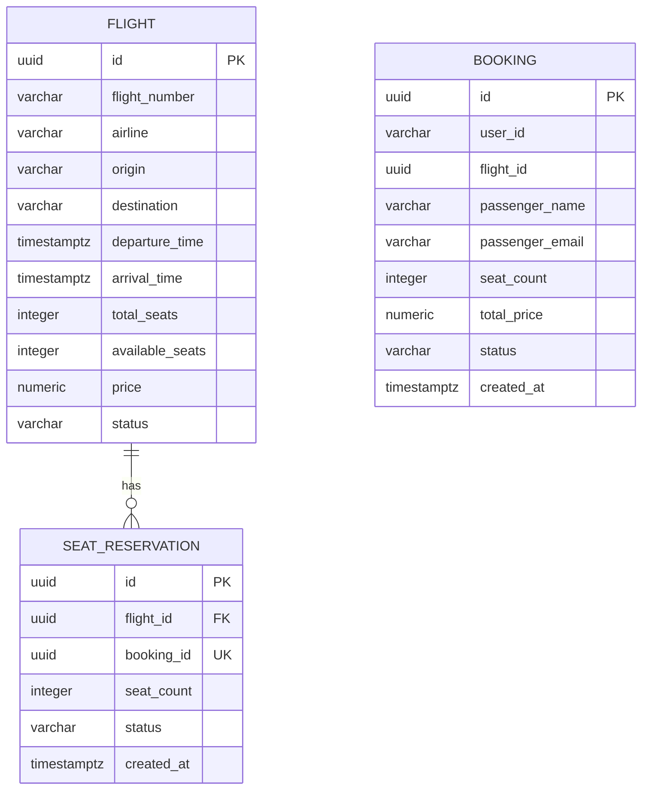

# Схема данных первого этапа

`FLIGHT` и `SEAT_RESERVATION` находятся в flight-db, `BOOKING` — в booking-db.
Идентификаторы `Booking.flight_id` и `SeatReservation.booking_id` ссылаются на
объекты другого сервиса логически: SQL FOREIGN KEY между этими базами нет.
Связь поддерживается межсервисными вызовами. Одному бронированию может
соответствовать одна резервация благодаря UNIQUE на `booking_id`; обеспечить
её создание должен будущий сценарий бронирования.

Данные о пассажире — снимок для конкретного бронирования. `user_id` — внешний
идентификатор пользователя; он не определяет имя пассажира и его email.
`total_price` — стоимость на момент покупки. В учебной системе цены считаем
в одной валюте — RUB. Для денег используются NUMERIC и Python Decimal.

Время хранится с часовым поясом. Для поиска по дате и уникальности номера
рейса используется календарная дата UTC. Дата отдельно не хранится:
уникальность обеспечивается индексом по `flight_number` и выражению
`(departure_time AT TIME ZONE 'UTC')::date`.

В таблицах нет списков в полях или отдельных повторяющихся групп; сведения
о рейсе не копируются в резервацию и бронирование. Неключевые поля описывают
свою сущность. Цена и данные пассажира в бронировании относятся к моменту
покупки и не обязаны совпадать с текущими данными другого объекта.

Ограничения базы проверяют положительные цену, общее число мест и размер
резервации, допустимые статусы, диапазон свободных мест, формат IATA-кодов,
разные аэропорты маршрута и порядок времени вылета и прилёта.

База не проверяет сумму мест всех активных резерваций: её согласованность
со счётчиком `available_seats` будет обеспечиваться транзакцией ReserveSeats
с блокировкой строки рейса.
