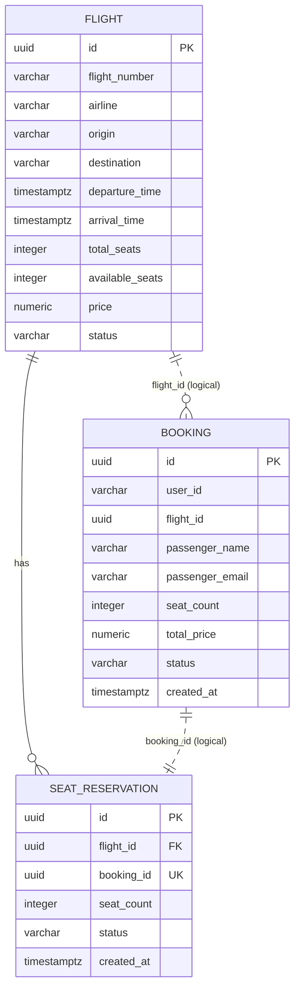

# Схема данных первого этапа

Flight и SeatReservation хранятся в flight-db, Booking — в booking-db.
Ссылки между сервисами передаются через ID, без внешних ключей между базами.

Время и дата поиска — UTC. Номер рейса уникален в пределах даты вылета UTC.
Цена хранится в рублях. total_price — стоимость на момент бронирования.
Данные пассажира относятся к конкретному бронированию.
